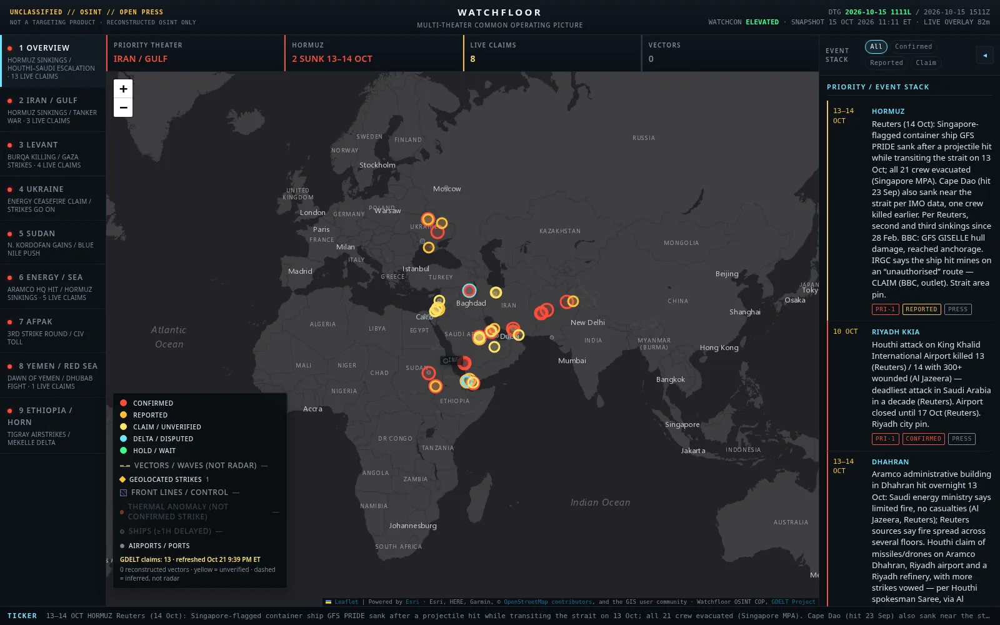
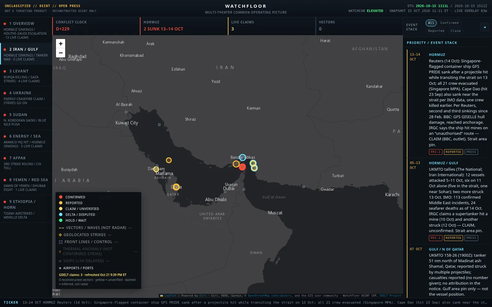
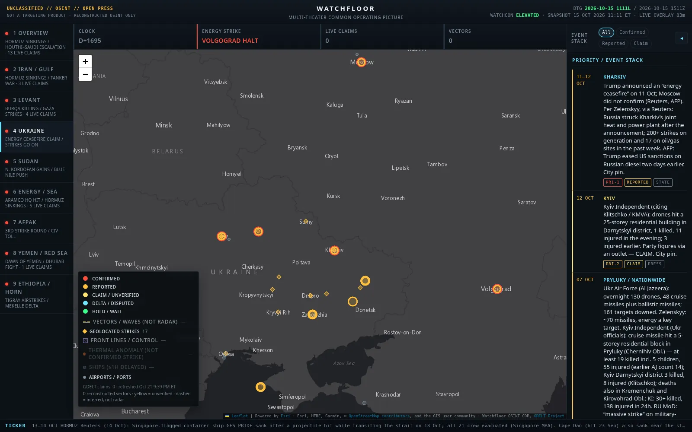

# Watchfloor

[](https://memery33.github.io/watchfloor/)

An unclassified open source intelligence (OSINT) common operating picture (COP) for following several conflicts at once.

**Live map:** https://memery33.github.io/watchfloor/

Watchfloor is a watch-floor view, not a news site. It is not a targeting product. It is reconstructed OSINT only. Every point is a reported claim with its source cited, not a confirmed strike. Every item carries a confidence tag and a source. Anything that isn't backed by named, corroborating sources stays **yellow** as a claim. It is not radar.

## Screenshots

The curated situation report (sitrep) snapshot in these shots is dated 15 Oct 2026. The live Global Database of Events, Language, and Tone (GDELT) overlay was refreshed Oct 21, 2026.



Iran and the Gulf, theater 2, with reported Hormuz and Gulf claims and their sources.



Ukraine, theater 4, with reported energy and strike claims and their sources.

## How sources are vetted

- **Named sources only.** Every event cites who reported it (wire services, official statements, United Kingdom Maritime Trade Operations (UKMTO), named outlets).
- **Claims stay yellow.** State media, militant channels, and automated news extraction are shown as CLAIM. They are promoted only when an independent, named source corroborates the same event, place, and date.
- **Disagreement is shown, not resolved.** When two credible sources contradict each other, the item is marked DELTA and both accounts stay visible.
- **No coordinates, no marker.** Nothing is plotted on a guessed location.
- **No two named ends, no arc.** Dashed missile and drone vectors are drawn only when both the launch point and the impact are named. They are reconstructions, not live tracks.

## What the colors mean

| Tag | Color | Meaning |
| --- | --- | --- |
| CONFIRMED | red | Named and corroborated. Still not targeting quality. |
| REPORTED | amber | Open press or official statement, not independently verified here. |
| CLAIM | yellow | State, militant, or automated extraction. Shown, not trusted. |
| DELTA | cyan | Credible sources contradict each other. |
| HOLD | green | Waiting on more information. |

## What's on the map

- Nine theaters: Overview, Iran/Gulf, Levant, Ukraine, Sudan, Energy/Sea, Afghanistan-Pakistan (AfPak), Yemen/Red Sea, and Ethiopia/Horn (keys `1` to `9`)
- Curated event stack for each theater, with source class and confidence
- Reconstructed missile and drone vectors where both ends are named
- Dark English basemap, Powered by Esri
- Live GDELT claim layer (below)

## The live claim layer

A yellow layer shows the last 6 hours of public [GDELT](https://www.gdeltproject.org/) claims. It is re-read on every refresh. It keeps only strike, shelling, and blockade events inside the watched areas. It drops country-level default locations, known bad geocodes, and vague actors. Because those filters are strict, the layer can still be thin or empty when news is quiet. An empty layer means nothing passed the filters, not that the feed is broken. The legend always shows the current count and the last refresh time.

Every GDELT row stays a CLAIM until the sitrep curator promotes it with named corroboration.

## Layers

- **Vectors:** reconstructed strike paths, drawn as arcs. A path draws only when both ends are named. It is inferred from reporting, not radar.
- **Strike pins:** town-level placements. Coordinates come from the National Geospatial-Intelligence Agency (NGA) GeoNames Server. Each pin names the outlet or official source. Its geolocator reads "Watchfloor (town-level placement)", so it isn't an exact geolocation.
- **Fronts:** catalog only. Nothing draws until a source is license-cleared.
- **Thermal anomalies (fires):** NASA Fire Information for Resource Management System (FIRMS), Visible Infrared Imaging Radiometer Suite (VIIRS) 375 m near-real-time. Off by default, and fetched only when switched on. Up to 400 points are drawn on desktop and 120 on phone. Likely gas flares are drawn small and muted. Each point is labeled "thermal anomaly, not confirmed strike".
- **Ships:** off until a license-cleared source exists.

The map draws a layer only when its license is cleared. The register is [docs/sources.md](docs/sources.md).

## How it stays current

- **Curated sitrep:** `src/sitrep.ts` and the per-theater `src/sitrep.*.ts` files, with a snapshot timestamp shown in the header.
- **Live layer:** `scripts/fetch_live.py` writes `public/data/live.json`. Every site build fetches the overlay fresh, so the deployed map is as current as its last build. A scheduled GitHub Action (nominally hourly, often less often) keeps the repo copy current and requests a site rebuild.
- **Vectors:** `src/tracks.ts`, curated by hand.
- **Site:** GitHub Pages rebuilds on every push to `main`, with a scheduled rebuild as a fallback.

## Run locally

```bash
npm install
python3 scripts/fetch_live.py
npm run dev
```

Keys: `1`-`9` switch theaters, `F` toggles fullscreen.

## Public by design

Open sources only. No classified, For Official Use Only (FOUO), or private Telegram material. If it can't be sourced publicly, it is a yellow claim or it does not plot.

## Data sources and licenses

One line per source. Full terms are in [docs/sources.md](docs/sources.md).

- **Esri basemap.** Powered by Esri. Attribution: Esri, HERE, Garmin, [OpenStreetMap contributors](https://www.openstreetmap.org/copyright), and the Geographic Information System (GIS) user community. Used under [Esri's terms of use](https://www.esri.com/en-us/legal/terms/full-master-agreement).
- **GDELT Project.** Free for any use with a citation and a link to [gdeltproject.org](https://www.gdeltproject.org/).
- **NASA FIRMS.** Open data. Cite as NASA FIRMS. [earthdata.nasa.gov/firms](https://earthdata.nasa.gov/firms). Disclaimer: [firms.modaps.eosdis.nasa.gov/download/Readme.txt](https://firms.modaps.eosdis.nasa.gov/download/Readme.txt).
- **Leaflet.** BSD 2 Clause. The license text is in [`THIRD_PARTY_NOTICES`](THIRD_PARTY_NOTICES).
- **OurAirports.** Public domain.
- **NGA GeoNames Server.** No restrictions. [geonames.nga.mil](https://geonames.nga.mil/).

News outlets are cited and linked, never republished.

## License

[MIT](LICENSE). Free and open source.
